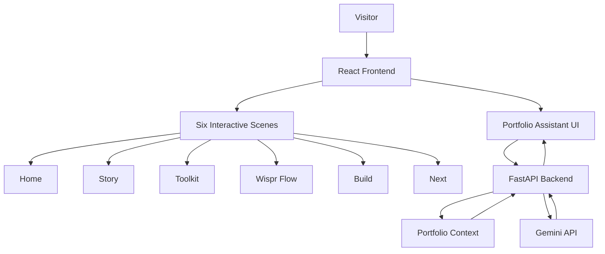
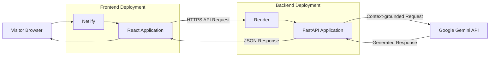
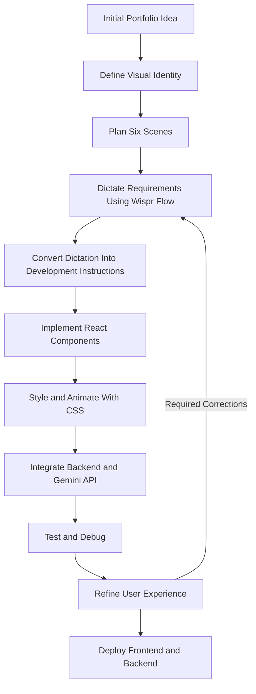
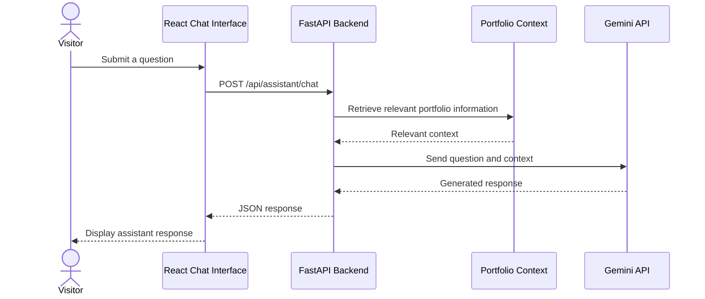

# Zaiba Muskan | Interactive Developer Portfolio

A personal portfolio showcasing my journey across software development, data, machine learning and applied AI — presented through an interactive, scrapbook-inspired digital experience.

**Live Website:** https://wispr-flow-portfolio.netlify.app  
**GitHub Repository:** https://github.com/zmuskan/wispr-flow-portfolio

---

## 1. Project Overview

This project is an interactive personal portfolio designed to go beyond the conventional developer portfolio experience.

Rather than presenting information through static sections, the website uses a six-scene storytelling experience combining visual design, custom illustrations, animations, interactive components and an AI-powered conversational assistant.

The visual direction draws inspiration from physical scrapbooks, editorial layouts, handwritten notes and textured paper.

The portfolio was also developed as part of the Wispr Flow Hiring Challenge, exploring how voice-driven workflows and AI-assisted development can accelerate the process of turning an idea into a functional product.

### Project Objectives

- Build a distinctive personal portfolio with a consistent visual identity.
- Present technical projects, skills and personal experiences through storytelling.
- Experiment with interactive UI components and custom animations.
- Integrate an AI-powered portfolio assistant.
- Demonstrate an end-to-end development and deployment workflow.
- Explore voice-driven development as part of the software creation process.

---

## 2. Technology Stack

| Category | Technology |
|---|---|
| Frontend | React.js |
| Programming Language | JavaScript |
| Styling | CSS3 |
| Backend | Python, FastAPI |
| AI Integration | Google Gemini API |
| Frontend Hosting | Netlify |
| Backend Hosting | Render |
| Version Control | Git, GitHub |
| Development Environment | Visual Studio Code |
| AI-Assisted Development | GitHub Copilot |

---

## 3. Application Architecture

The application follows a separate frontend and backend architecture.

The React frontend handles the portfolio experience and user interactions. The FastAPI backend exposes the AI assistant endpoint, which communicates with the Gemini API and uses portfolio-specific context to generate relevant responses.

### High-Level Architecture



### Deployment Architecture



---

## 4. Portfolio Structure

The portfolio is organised into six interconnected scenes.

| Scene | Description |
|---|---|
| Home | Introduction, personal identity, visual storytelling and interactive elements. |
| Story | Academic background, experiences, interests and personal journey. |
| Toolkit | Technologies, development tools and technical skills. |
| Wispr Flow | Documentation of the voice-driven portfolio development process. |
| Build | Projects, experiments and development work. |
| Next | Future ambitions, professional interests and opportunities. |

Each scene maintains the same design language while presenting a different part of the portfolio.

---

## 5. Interactive Features

### 5.1 Interactive Scrapbook

The Home scene features a custom parchment-style interactive note.

Features include:

- Interactive open and close behaviour.
- Hidden messages revealed through user interaction.
- Custom scrapbook-inspired styling.
- Animated decorative birds.
- Responsive positioning and transitions.

### 5.2 Custom Walking Character Cursor

A custom SVG character inspired by my own appearance and outfit.

The cursor uses pointer tracking and movement-based animation.

Features:

- Follows the visitor's mouse.
- Walking animation activates during pointer movement.
- Character animation pauses when the pointer becomes idle.
- Custom SVG artwork.
- Separate animation handling for character movement.

### 5.3 Footstep Audio

A lightweight audio interaction accompanying the walking character.

The implementation uses the Web Audio API rather than requiring an external audio streaming service.

Features:

- Footsteps synchronised with the walking state.
- Audio stops when the pointer becomes idle.
- Audio resources and timers are managed by the cursor component.
- Browser audio restrictions are respected.

### 5.4 Interactive GIF Easter Egg

A personal GIF included as a hidden visual interaction.

Features:

- Blurred preview.
- Click-to-reveal interaction.
- Ability to hide the GIF again.
- Original GIF animation preserved.
- Positioned independently from the main scene layout.

### 5.5 Wispr Flow Phone Demonstration

An interactive phone-inspired chat interface demonstrating a conversational experience.

Features:

- Editable message input.
- Send interaction.
- Microphone interface.
- Replay and clear controls.
- Text-to-speech functionality.
- Custom conversational content.

### 5.6 Cinematic Final Scene

The final scene uses a full-screen video presentation.

Features:

- Full-screen video treatment.
- Responsive video cropping.
- Readability overlay.
- Pointer-responsive visual ripple effect.
- Integrated portfolio navigation.

---

## 6. Wispr Flow Development Workflow

A major part of this project was experimenting with voice-driven development.

The goal was to use natural-language instructions to communicate design decisions, generate implementation requirements and iterate on the portfolio.

### Development Workflow



### Iterative Development Process

The development process involved multiple cycles of:

1. Expressing an idea through voice.
2. Converting the idea into a structured instruction.
3. Implementing the required component.
4. Reviewing the result in the browser.
5. Identifying visual or functional issues.
6. Refining the implementation.
7. Testing the complete experience.

This workflow helped explore the relationship between voice interfaces, AI-assisted coding and frontend development.

---

## 7. Backend and AI Integration

The backend is implemented using FastAPI and integrates with Google's Gemini API.

The portfolio assistant is designed to answer questions related to the portfolio using relevant project context.

### Request Flow



### Backend Responsibilities

- Expose the assistant API endpoint.
- Handle incoming chat requests.
- Retrieve relevant portfolio context.
- Communicate with the Gemini API.
- Return generated responses to the frontend.

The backend requires a valid Gemini API key configured through environment variables.

---

## 8. Repository Structure

The repository is divided into frontend and backend applications.

```text
wispr-flow-portfolio/
│
├── backend/
│   ├── main.py
│   ├── requirements.txt
│   ├── .env.example
│   └── ...
│
├── frontend/
│   ├── public/
│   │   └── assets/
│   │       ├── images/
│   │       └── ...
│   │
│   ├── src/
│   │   ├── components/
│   │   │   ├── cursor/
│   │   │   └── scrapbook/
│   │   │
│   │   ├── scenes/
│   │   │   ├── HomeScene.js
│   │   │   ├── StoryScene.js
│   │   │   ├── ToolkitScene.js
│   │   │   ├── WisprScene.js
│   │   │   ├── BuildScene.js
│   │   │   └── NextScene.js
│   │   │
│   │   ├── data/
│   │   ├── App.js
│   │   └── index.css
│   │
│   ├── package.json
│   └── ...
│
├── .gitignore
├── README.md
└── LICENSE
```

Note: This is a representative overview. Refer to the repository for the complete and current file structure.

---

## 9. Running the Project Locally

### Prerequisites

- Node.js
- npm
- Python 3.10+
- Git
- Gemini API key for the AI assistant

### Step 1: Clone the Repository

```bash
git clone https://github.com/zmuskan/wispr-flow-portfolio.git

cd wispr-flow-portfolio
```

### Step 2: Configure the Frontend

```bash
cd frontend

npm install

npm start
```

The frontend development server should be available at:

```text
http://localhost:3000
```

### Step 3: Configure the Backend

Open another terminal:

```bash
cd backend
```

Create a Python virtual environment:

```bash
python -m venv venv
```

Activate it on Windows:

```bash
venv\Scripts\activate
```

Install the dependencies:

```bash
pip install -r requirements.txt
```

### Step 4: Configure Environment Variables

Create a `.env` file in the backend directory using `.env.example` as a reference.

Example:

```env
GEMINI_API_KEY=your_gemini_api_key
CORS_ORIGINS=http://localhost:3000
```

Never commit the actual `.env` file or expose API credentials.

### Step 5: Start the Backend

Use the ASGI entry point configured in the backend.

For example, if the FastAPI application is exposed as `app` in `main.py`:

```bash
uvicorn main:app --reload
```

The API documentation is generally available at:

```text
http://127.0.0.1:8000/docs
```

---

## 10. Environment Configuration

| Variable | Description |
|---|---|
| `GEMINI_API_KEY` | API key used for Gemini integration. |
| `CORS_ORIGINS` | Permitted frontend origins. |

The `.env.example` file should contain placeholders only.

Production credentials should be configured through the hosting provider's environment-variable settings.

---

## 11. Deployment

### Frontend Deployment — Netlify

The frontend is deployed through Netlify.

Deployment workflow:

1. Connect the GitHub repository.
2. Configure the frontend build directory.
3. Install npm dependencies.
4. Execute the production build.
5. Publish the generated build output.
6. Configure SPA redirects if necessary.

### Backend Deployment — Render

The backend is deployed separately through Render.

Deployment workflow:

1. Connect the GitHub repository.
2. Configure the backend root directory.
3. Install Python dependencies.
4. Configure the FastAPI start command.
5. Add the required environment variables.
6. Configure the allowed frontend origin.

The frontend communicates with the backend through its deployed API endpoint.

---

## 12. Testing and Validation

Before deploying changes, validate the following:

### Frontend

- All six scenes load.
- Navigation works correctly.
- Scene transitions work.
- Images, GIFs and videos load.
- Interactive elements respond correctly.
- Cursor movement and animation behave correctly.
- Desktop and mobile layouts remain usable.

### Backend

- FastAPI starts successfully.
- API endpoint responds correctly.
- Gemini API credentials are configured.
- Portfolio context is available.
- CORS permits the deployed frontend.
- Errors are handled without exposing secrets.

### Production Build

```bash
cd frontend

npm run build
```

---

## 13. Future Improvements

Potential improvements include:

- More extensive accessibility testing.
- Improved mobile interaction support.
- Further optimisation of visual assets.
- Additional automated tests.
- Enhanced AI assistant capabilities.
- Further refinement of animations and transitions.

---

## 14. About

I'm Zaiba Muskan D.M., with an academic background in Chemical Engineering and a growing focus on software development, data science, machine learning and applied AI.

I enjoy exploring unfamiliar technologies, building practical applications and working across the development process — from understanding a problem and designing a solution to implementation, debugging and deployment.

This portfolio represents that approach: a combination of technical experimentation, visual storytelling and hands-on product development.

---

## 15. Connect

- **Portfolio:** https://wispr-flow-portfolio.netlify.app
- **GitHub:** https://github.com/zmuskan
- **LinkedIn:** Add your LinkedIn profile URL.
- **Email:** Add your preferred public contact email.

---

## 16. Copyright and Usage

Copyright © 2026 Zaiba Muskan D.M. All rights reserved.

This repository is publicly available for portfolio viewing and evaluation.

Unless otherwise stated, the original source code, visual design, custom illustrations, animations, written content and creative assets are protected by copyright.

No permission is granted to reproduce, redistribute, modify, republish, commercially exploit or create derivative works from these original materials without prior written permission.

Third-party libraries, frameworks, APIs, fonts and media remain subject to their respective licences and terms.

**Public access to this repository does not constitute permission to copy or reuse its original work.**
